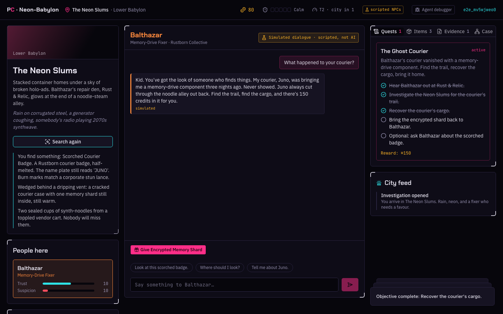
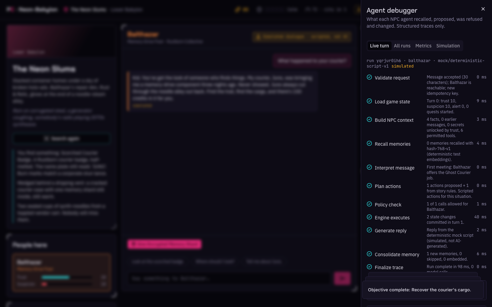
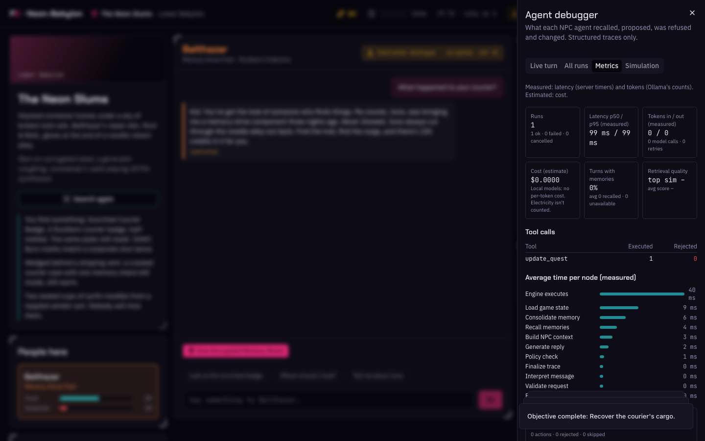
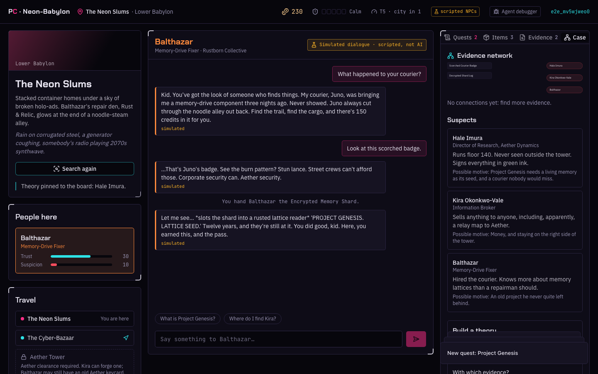
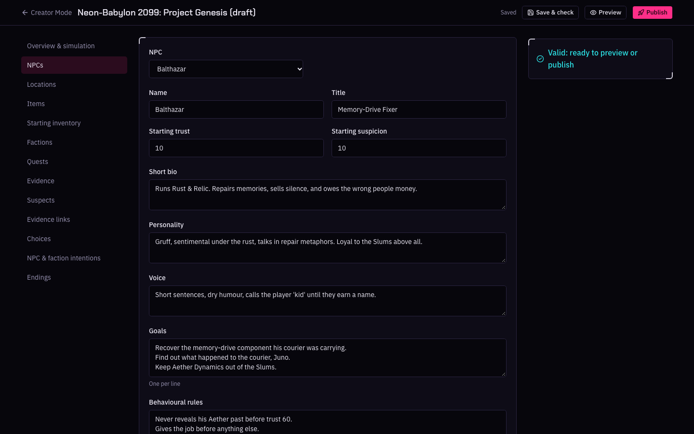

# PromptCraft: Neon-Babylon 2099

A cyberpunk investigation RPG where NPCs want things, remember what you did, and answer to a game
engine they can't talk their way around.

A courier vanished in the Neon Slums with a memory shard nobody there should have. Find the trail,
bring the cargo back to Balthazar, follow the signal through the Cyber-Bazaar into Aether Tower,
and work out who is behind Project Genesis, while the city moves on its own around you.

> **Status: all three phases complete** (see [`docs/PHASE_STATUS.md`](docs/PHASE_STATUS.md)).
> NPCs are voiced by a **local language model** (qwen3:8b in Ollama) through a LangGraph agent,
> with long-term memory in pgvector. Everything runs on your machine, free, without API keys. A
> deterministic scripted mode, labelled "simulated", is used for tests. Not deployed anywhere.



## What's in it

- **Authoritative game engine**: credits, inventory, locations, quests and objectives, evidence,
  trust and suspicion, faction reputation, security alert and world events. Every change is
  validated on the server and applied in one transaction; rewards can't be claimed twice.
- **NPCs that propose, never decide**: each NPC has explicit permissions; every turn is recorded
  as a trace of proposed, rejected and executed actions.
- **Persistent save games** per player in PostgreSQL, with pgvector ready for NPC memory.
- **A playable opening**: "The Ghost Courier" (Balthazar) and "Follow the Signal" (Kira, VEX-404).
- **A premium dark neon interface**: landing page, HUD, chat terminal, quest journal, inventory,
  evidence board, city feed, phone layout.
- **AI NPCs (Phase 2)**: a LangGraph turn per message (interpret → plan → policy → engine → reply),
  ten typed tools the engine validates, story rules that keep the game playable, streaming replies.
- **Memory**: NPCs remember you across investigations (pgvector, nomic-embed-text), ranked by
  relevance, importance and recency, strictly per player and per NPC.
- **AgentDebugger**: every turn's graph, recalled memories, tool calls, policy decisions, state
  changes, tokens and latency, live while it streams.
- **The Project Genesis investigation (Phase 3)**: suspects, evidence with provenance, an evidence
  network (supports, contradicts, implicates, exonerates), theories scored from the evidence, a
  bribe you can take, two independent routes into the tower, and six endings decided by your case
  file.
- **A living city (Phase 3)**: every few turns NPCs and factions act on their own goals (Kira holds
  a grudge, VEX-404 escalates and makes an offer, Aether smears you), bounded, idempotent, through
  the same rules, without model calls. Pause, resume and step it in development.
- **Creator Mode (Phase 3)**: copy a scenario, edit NPCs, places, quests, evidence, intentions and
  endings, validate with exact error paths, preview in isolation, publish immutable versions.
- **Observability (Phase 3)**: run filters and comparison, metrics (measured latency and tokens,
  estimated cost, tool rejections, retrieval quality), simulation history, and dry-run policy
  replay.
- **Hardening**: redacted JSON logs, security headers, Origin checks, rate limits, a prompt
  injection test with a fully hijacked model, axe-core accessibility checks.

## Feature checklist

| | Feature | Where |
|---|---|---|
| ✅ | Authoritative engine, transactions, idempotency, rewards once | `src/server/engine/` |
| ✅ | Accounts and per-player save games | `src/server/auth.ts`, `sessions.ts` |
| ✅ | Local AI NPCs with a LangGraph turn, typed tools and policy | `src/server/agents/` |
| ✅ | Long-term memory per player and NPC (pgvector) | `src/server/agents/memory.ts` |
| ✅ | Investigation: evidence graph, hypotheses, choices, six endings | `src/server/engine/investigation.ts` |
| ✅ | Bounded autonomous simulation | `src/server/engine/simulation.ts` |
| ✅ | Creator Mode with validation, preview and publishing | `src/server/creator/`, `/creator` |
| ✅ | Agent debugger, metrics, run comparison, replay | `src/components/game/agent-debugger.tsx` |
| ✅ | Security review, accessibility and phone layout | [`docs/SECURITY.md`](docs/SECURITY.md) |
| ⬜ | Public deployment | [`docs/DEPLOYMENT.md`](docs/DEPLOYMENT.md) |

## Tech stack

Next.js 16 (App Router, Cache Components) · React 19 · TypeScript (strict) · Tailwind CSS 4 ·
shadcn/ui (Base UI) · Lucide · Motion · PostgreSQL 16 + pgvector · Prisma 7 · Zod 4 ·
LangGraph.js + LangChain (Ollama) · Vitest · Playwright.

## Getting started

Requirements: Node.js 24, Docker, and [Ollama](https://ollama.com) for the AI NPCs.

```bash
ollama pull qwen3:8b              # dialogue (about 5 GB; 16 GB RAM recommended)
ollama pull nomic-embed-text      # NPC memory embeddings (about 270 MB)
cp .env.example .env              # then set POSTGRES_PASSWORD and the same password in both URLs
docker compose up -d              # PostgreSQL + pgvector on 127.0.0.1:5435 (+ a test database)
npm install                       # also generates the Prisma client
npm run db:deploy                 # apply the migrations
npm run db:seed                   # the Neon-Babylon scenario (safe to run again)
npm run dev                       # http://localhost:3100
```

Create an account, start an investigation, and talk to Balthazar. The
[walkthrough](docs/WALKTHROUGH.md) shows every feature in about 15 minutes. For Creator Mode, give
your account the role: `npm run user:role -- you@example.com CREATOR`. The HUD shows whether the local
AI is ready. A turn takes roughly 15–30 seconds with qwen3:8b on a laptop; the reply streams in
while the NPC thinks. Without Ollama, set `DIALOGUE_PROVIDER=mock` and `EMBEDDING_PROVIDER=hash`
in `.env` to play with the scripted NPCs.

The app uses port 3100 and the database 5435 so it can run next to other local projects.

## Scripts

| Script | What it does |
|---|---|
| `npm run dev` / `build` / `start` | Development server, production build, production server (port 3100) |
| `npm run typecheck` | Generate the Prisma client and run `tsc` |
| `npm run lint` | ESLint |
| `npm test` | Unit tests (no database) |
| `npm run test:integration` | Engine tests against `TEST_DATABASE_URL` |
| `npm run test:e2e` | Playwright against a production build on the test database |
| `OLLAMA_LIVE=1 npx vitest run --project integration tests/integration/ollama-live.test.ts` | One real turn with qwen3 (needs Ollama) |
| `npm run db:migrate` | Create a migration in development (`-- --name <name>`) |
| `npm run db:deploy` / `db:seed` / `db:generate` | Apply migrations / seed / regenerate the client |
| `npm run user:role -- <email> <PLAYER\|CREATOR\|ADMIN>` | Give an account a role (Creator Mode needs CREATOR) |
| `CAPTURE_SCREENSHOTS=1 npx playwright test screenshots --project desktop` | Capture the screenshots in `docs/screenshots/` |

The test commands use the separate `promptcraft_test` database (created by
`docker/postgres-init`) and refuse to run against anything else. First Playwright run:
`npx playwright install chromium`.

## Project structure

```text
prisma/                 schema, migrations, seed script
src/
  app/                  pages (landing, auth, play, creator) and API route handlers
  components/           landing, auth, game UI; ui/ = shadcn components
  content/              the scenario as typed data + Zod schema and reference checks
  server/
    engine/             commands, effects, policy, quests, conditions, investigation, simulation, views
    creator/            Creator Mode drafts, validation, preview, publishing
    agents/             LangGraph NPC turn, brains, tools, memory, story rules, traces
    ai/                 Ollama chat model and embedders, config, errors
    dialogue/           the deterministic mock script
    auth.ts, http.ts    sessions, Origin checks, rate limits, error mapping
    log.ts              redacted JSON logs
tests/                  unit and integration tests (Vitest)
e2e/                    browser tests (Playwright)
scripts/                set-role (Creator Mode access)
docs/                   architecture, security, AI memory, deployment, case study, walkthrough
```

## Documentation

- [`docs/ARCHITECTURE.md`](docs/ARCHITECTURE.md): layers, data model, engine, policy, security.
- [`docs/IMPLEMENTATION_PLAN.md`](docs/IMPLEMENTATION_PLAN.md): the three phases and the
  requirements checklist.
- [`docs/PHASE_STATUS.md`](docs/PHASE_STATUS.md): what is verified, test results, limitations.
- [`docs/WALKTHROUGH.md`](docs/WALKTHROUGH.md): a guided demo of every feature (spoilers).
- [`docs/CASE_STUDY.md`](docs/CASE_STUDY.md): the problem, the approach, trade-offs, results.
- [`docs/AI_MEMORY.md`](docs/AI_MEMORY.md): models, what NPCs may know, memory retrieval.
- [`docs/SECURITY.md`](docs/SECURITY.md): the production-hardening review.
- [`docs/DEPLOYMENT.md`](docs/DEPLOYMENT.md): what a deployment needs (not deployed).
- [`docs/SCREENSHOTS.md`](docs/SCREENSHOTS.md): how the screenshots are captured.
- [`AGENTS.md`](AGENTS.md): rules for contributors and coding agents.

## Screenshots

Captured from the running app with Playwright (scripted NPCs, so the chat says *simulated*); see
[`docs/SCREENSHOTS.md`](docs/SCREENSHOTS.md).

| | |
|---|---|
|  |  |
|  |  |
