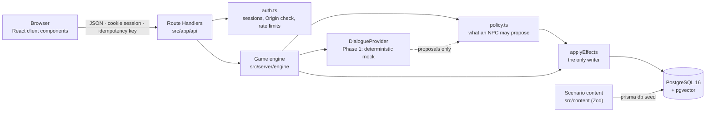

# Architecture

PromptCraft is one Next.js 16 application (App Router) with a PostgreSQL database. The browser
renders the game; every rule runs on the server.

## Layers

| Layer | Where | Responsibility |
|---|---|---|
| Pages | `src/app/page.tsx`, `(auth)/`, `play/` | Static shells. The landing page is prerendered; the game is a client component behind `<Suspense>` that talks to the API. |
| Route Handlers | `src/app/api/**/route.ts` | HTTP only: authenticate, check the Origin on mutations, rate-limit, parse, call the engine, return JSON. `src/server/http.ts` maps errors. |
| Auth | `src/server/auth.ts` | bcrypt passwords, random 256-bit session tokens in an httpOnly cookie, only the SHA-256 hash stored (`AuthSession`). |
| Engine | `src/server/engine/` | Commands, effects, quest evaluation, policy, views. Pure server code, testable without HTTP. |
| Dialogue | `src/server/dialogue/` | The `DialogueProvider` interface and the deterministic mock. |
| Content | `src/content/` | The authored scenario as typed data plus its Zod schema and reference validation. |
| Data | `prisma/` | Schema, migrations, seed. Prisma 7 with the `pg` driver adapter; client generated into `src/generated/prisma`. |

### Why the game screen is a client component

Next.js 16 runs with Cache Components: reading cookies during render must happen inside a
`<Suspense>` boundary, and the result can't be part of the prerendered shell. The game state is
per player and changes on every action, so pages stay static shells and the client fetches state
from Route Handlers, which run per request. The same endpoints serve the end-to-end tests and,
in Phase 2, the streaming chat.

## Data model

Two kinds of data, kept apart:

- **Scenario content** (`Scenario → ScenarioVersion → Location, Faction, NPC, ItemDefinition,
  Quest, QuestObjective, Evidence, LocationLoot, MerchantOffer`). Written by the seed, never by
  gameplay. A version is immutable once seeded; a `GameSession` pins the version it started on,
  so editing content (Creator Mode, Phase 3) never changes a running save game.
- **Player state** (`User → GameSession → WorldState, LocationAccess, NPCRelationship,
  FactionReputation, InventoryItem, CollectedLoot, QuestState, ObjectiveProgress,
  DiscoveredEvidence, Conversation, Message, WorldEvent, GameEvent, NPCMemory, AgentRun`).
  Everything hangs off one `GameSession` owned by one user; deleting a user cascades.

Integrity is enforced twice: by the engine and by the database (unique constraints such as one
`QuestState` per quest and session, and CHECK constraints for credits ≥ 0, alert 0…5, trust
−100…100, suspicion 0…100, reputation −100…100, quantity > 0, importance 1…10).

`NPCMemory` already has an `embedding vector` column (pgvector extension created by the first
migration) plus `contentHash` for deduplication and `provenance`. Phase 2 fixes the dimension
together with the embedding model and adds an index.

## The engine

### Commands

`executeCommand(prisma, { userId, sessionId, command, idempotencyKey, provider })` accepts five
commands (Zod schema in `commands.ts`): `travel`, `investigate`, `talk`, `give`, `buy`. One
command is one transaction:

1. Load the session **for this user** (else 404) and lock its `WorldState` row
   (`SELECT … FOR UPDATE`), so commands for one session run one at a time.
2. If a `GameEvent` with this idempotency key exists, return its stored result (`replayed: true`).
   A reused key for a different command type is rejected.
3. Load the session context (content + state as plain data).
4. Run the command handler. It validates preconditions (location unlocked, NPC reachable, item
   owned, enough credits, …) and throws a `GameError` if the command can't happen at all; nothing
   is written then.
5. `evaluateQuests` completes objectives that follow from state, completes quests and grants
   rewards, and starts follow-up quests.
6. Increase the turn and store the `GameEvent` with its result.

### Effects

Every state change is an effect (`effects.ts`): `credits`, `item_grant`, `item_remove`,
`evidence`, `trust`, `suspicion`, `alert`, `faction`, `unlock_location`, `quest_start`,
`objective`, `world_event`, `memory`. Effects use content keys, never database ids, so nothing a
client or a model sends can point at another player's rows.

`applyEffects` is the only writer. Each effect is checked against the current state, written, and
mirrored into the in-memory context so the next check sees it. An effect that can't apply (already
owned, already discovered, alert already at 5) is *skipped with a reason* rather than failing the
command; the reason ends up in the trace.

### Rewards exactly once

A quest's reward is granted by the transaction that flips `QuestState.rewardGrantedAt` from null
(`updateMany … where rewardGrantedAt: null`). Together with the row lock and the idempotency key,
two simultaneous deliveries can't both pay out. An integration test fires two at once.

### Quests

Objective kinds `TALK_TO`, `VISIT_LOCATION`, `DISCOVER_EVIDENCE` and `COLLECT_ITEM` follow from
state and are completed by the engine only. `DELIVER_ITEM` is completed by the `give` command;
`ASK_ABOUT` can be proposed by the recipient NPC but requires the player to hold the evidence.
Quests and objectives carry data-driven `onCompleteEffects` (unlock a location, change
reputation, record a world event or memory), validated when the scenario is seeded.

## NPC turns, policy and traces

`talk` runs a fixed pipeline and records it as an `AgentRun` with `AgentStep`s:
`validate_request → load_state → retrieve_memories → interpret → policy_check → execute → respond`.

- **retrieve_memories**: only this NPC's memories of this player in this save game, ordered by
  importance (Phase 2: semantic retrieval with pgvector, recency and importance ranking).
- **interpret**: the dialogue provider returns text, an intent label, a one-line summary and
  proposed effects. It gets no database access and no other NPC's data.
- **policy_check** (`policy.ts`): per-NPC `allowedEffects` from the content, plus rules: an NPC
  only changes its own trust, suspicion and memories, only starts quests it gives, only hands over
  evidence it holds, only changes its own faction's reputation (±10), raises the alert by at most
  one level per turn and never lowers it, at most six proposals per turn. Malformed proposals are
  rejected.
- **execute**: allowed proposals go through `applyEffects`. Every proposal becomes a
  `ToolExecution` row: `EXECUTED`, or `REJECTED` with the policy's or the engine's reason.

Steps store short summaries and structured data, never hidden reasoning.

## Dialogue providers

`DialogueProvider` (`src/server/dialogue/types.ts`) has `reply`, `reactToItem` and `suggestions`.
Phase 1 ships only `mockDialogueProvider`: a keyword-and-state script per NPC, deterministic (the
same state and message give the same reply), `isSimulated: true`. Every NPC message stores its
provider and `isSimulated`, and the UI labels the conversation and each simulated line.
`getDialogueProvider` fails loudly for any provider other than `mock` instead of falling back.

Phase 2 note: a model call must not hold the database transaction open. The plan is to split the
turn into a read phase (context, memories), the model call, and a short write transaction
(policy + `applyEffects`), keeping the same trace.

## Security

| Concern | Measure |
|---|---|
| Passwords | bcrypt (cost 12); unknown emails compare against a dummy hash so timing doesn't reveal accounts |
| Sessions | 256-bit random token, httpOnly, SameSite=Lax, Secure in production, 14 days; only the hash is stored |
| CSRF | SameSite=Lax cookies plus an Origin check on every mutating request (`APP_ORIGIN` for proxies) |
| Authorization | Every read and command resolves the session through `userId`; foreign sessions are 404 |
| Input | Zod on every body; content keys restricted to `[a-z0-9-]`; messages 1–500 characters |
| Abuse | In-memory rate limits for register, login (per email and IP), commands and new sessions; max 5 open investigations |
| Errors | Players see `GameError` messages; anything else is a generic 500 and is logged without bodies, cookies or passwords |
| Open redirects | `?next=` after sign-in only accepts paths inside the app |

Limitations: rate limits are per process (a multi-instance deployment needs a shared store such as
Redis); there is no password reset or email verification yet.

## Testing

- **Unit** (`tests/unit`): mock provider determinism and rules, the NPC policy, effect validation,
  scenario reference validation. No database.
- **Integration** (`tests/integration`): the engine against the real `promptcraft_test` database:
  the full opening walkthrough, idempotency, simultaneous deliveries, locked locations, credits,
  alert bounds, trade refusal, cross-player isolation, memory isolation, agent-run recording.
- **End-to-end** (`e2e/`): Playwright against a production build (`next start`) on the test
  database: both quests in a browser, persistence after reload, sign-in redirects, a foreign game,
  the phone layout.
