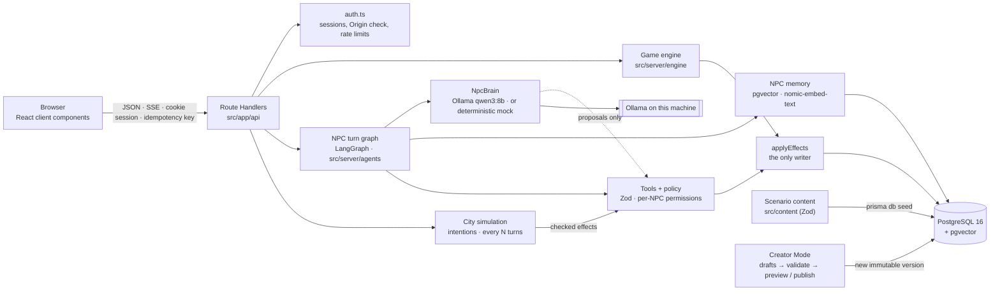

# Architecture

PromptCraft is one Next.js 16 application (App Router) with a PostgreSQL database. The browser
renders the game; every rule runs on the server.



## Layers

| Layer | Where | Responsibility |
|---|---|---|
| Pages | `src/app/page.tsx`, `(auth)/`, `play/` | Static shells. The landing page is prerendered; the game is a client component behind `<Suspense>` that talks to the API. |
| Route Handlers | `src/app/api/**/route.ts` | HTTP only: authenticate, check the Origin on mutations, rate-limit, parse, call the engine, return JSON. `src/server/http.ts` maps errors. |
| Auth | `src/server/auth.ts` | bcrypt passwords, random 256-bit session tokens in an httpOnly cookie, only the SHA-256 hash stored (`AuthSession`). |
| Engine | `src/server/engine/` | Commands, effects, quest evaluation, policy, views. Pure server code, testable without HTTP. |
| AI providers | `src/server/ai/` | Configuration, the Ollama chat model (LangChain `ChatOllama`), embedders, normalised errors. Local only, no API keys. |
| Agents | `src/server/agents/` | The LangGraph NPC turn, the `NpcBrain` (Ollama or mock), tools, memory, story rules, traces, runs for the debugger. |
| Dialogue script | `src/server/dialogue/` | The deterministic mock script (Phase 1), now behind the `MockBrain`. |
| Content | `src/content/` | The authored scenario as typed data plus its Zod schema and reference validation. |
| Creator | `src/server/creator/` | Drafts, validation with paths, isolated previews and publishing new versions (Phase 3). |
| Data | `prisma/` | Schema, migrations, seed. Prisma 7 with the `pg` driver adapter; client generated into `src/generated/prisma`. |

### Why the game screen is a client component

Next.js 16 runs with Cache Components: reading cookies during render must happen inside a
`<Suspense>` boundary, and the result can't be part of the prerendered shell. The game state is
per player and changes on every action, so pages stay static shells and the client fetches state
from Route Handlers, which run per request. The same endpoints serve the end-to-end tests and,
in Phase 2, the streaming chat.

## Data model

Two kinds of data, kept apart:

- **Scenario content** (`Scenario → ScenarioVersion → Location, Faction, NPC, ItemDefinition,
  Quest, QuestObjective, Evidence, LocationLoot, MerchantOffer`, and since Phase 3 `Suspect,
  EvidenceLink, Choice, NpcIntention, Ending`). Written by the seed or by Creator Mode, never by
  gameplay. A published version is immutable; a `GameSession` pins the version it started on, so
  publishing a new version never changes a running save game. `ScenarioVersion.definition` keeps
  the full JSON the version was made from (status `DRAFT`, `PREVIEW` or `PUBLISHED`).
- **Player state** (`User → GameSession → WorldState, LocationAccess, NPCRelationship,
  FactionReputation, InventoryItem, CollectedLoot, QuestState, ObjectiveProgress,
  DiscoveredEvidence, Conversation, Message, WorldEvent, GameEvent, NPCMemory, AgentRun`, and
  since Phase 3 `PlayerChoice, Hypothesis, CaseFile, SimulationState, SimulationTick,
  IntentionRun`).
  Everything hangs off one `GameSession` owned by one user; deleting a user cascades.

Integrity is enforced twice: by the engine and by the database (unique constraints such as one
`QuestState` per quest and session, and CHECK constraints for credits ≥ 0, alert 0…5, trust
−100…100, suspicion 0…100, reputation −100…100, quantity > 0, importance 1…10).

`NPCMemory` has an `embedding vector(768)` column with an HNSW index (pgvector), plus
`contentHash` for deduplication and `provenance`; see "NPC memory" below.

## The engine

### Commands

`executeCommand(prisma, { userId, sessionId, command, idempotencyKey, reactions })` accepts the
commands in `commands.ts` (Zod schema): `travel`, `investigate`, `give`, `buy`, and since Phase 3
`choose`, `save_hypothesis`, `discard_hypothesis` and `submit_case`. Talking is an NPC turn (see
the turn graph). One command is one transaction:

1. Load the session **for this user** (else 404) and lock its `WorldState` row
   (`SELECT … FOR UPDATE`), so commands for one session run one at a time.
2. If a `GameEvent` with this idempotency key exists, return its stored result (`replayed: true`).
   A reused key for a different command type is rejected.
3. Load the session context (content + state as plain data).
4. Run the command handler. It validates preconditions (location unlocked, NPC reachable, item
   owned, enough credits, …) and throws a `GameError` if the command can't happen at all; nothing
   is written then.
5. `evaluateQuests` completes objectives that follow from state, completes quests and grants
   rewards, and starts follow-up quests.
6. Increase the turn and store the `GameEvent` with its result.

### Effects

Every state change is an effect (`effects.ts`): `credits`, `item_grant`, `item_remove`,
`evidence`, `trust`, `suspicion`, `alert`, `faction`, `unlock_location`, `quest_start`,
`objective`, `world_event`, `memory`, `offer_choice`. Effects use content keys, never database ids, so nothing a
client or a model sends can point at another player's rows.

`applyEffects` is the only writer. Each effect is checked against the current state, written, and
mirrored into the in-memory context so the next check sees it. An effect that can't apply (already
owned, already discovered, alert already at 5) is *skipped with a reason* rather than failing the
command; the reason ends up in the trace.

### Rewards exactly once

A quest's reward is granted by the transaction that flips `QuestState.rewardGrantedAt` from null
(`updateMany … where rewardGrantedAt: null`). Together with the row lock and the idempotency key,
two simultaneous deliveries can't both pay out. An integration test fires two at once.

### Quests

Objective kinds `TALK_TO`, `VISIT_LOCATION`, `DISCOVER_EVIDENCE` and `COLLECT_ITEM` follow from
state and are completed by the engine only. `DELIVER_ITEM` is completed by the `give` command;
`ASK_ABOUT` can be proposed by the recipient NPC but requires the player to hold the evidence.
Quests and objectives carry data-driven `onCompleteEffects` (unlock a location, change
reputation, record a world event or memory), validated when the scenario is seeded.

Phase 3 adds `TRUST_AT_LEAST` (follows from state) and `CLOSE_CASE` (completed only by
`submit_case`). Locations can list `unlockItemKeys`: holding any of those items opens them, which
is how both the forged clearance and Balthazar's keycard open Aether Tower.

### Conditions

`conditions.ts` defines data-driven conditions used by intentions and story content: quest and
objective status, evidence and items held, alert above or below a level, trust, suspicion and
reputation thresholds, memory kinds an NPC holds about the player, world events, choices offered or
made, locations visited and the simulation tick. `holds(condition, state)` is pure and unit-tested.

## The investigation (Phase 3)

Project Genesis is the third quest. Its data lives in the scenario: suspects, evidence (with
provenance: found in a location, given by an NPC, disputed testimony), typed `EvidenceLink`s
(`SUPPORTS`, `CONTRADICTS`, `LEADS_TO`, `IMPLICATES`, `EXONERATES`), choices and endings.

- **Visible links** (`investigation.ts`): a link is shown only when the player knows both ends, so
  the evidence network grows as the case does.
- **Hypotheses**: a theory is a suspect plus up to eight pieces of discovered evidence (at most
  ten per session). `assessHypothesis` scores it from the visible links (implicates +1, exonerates
  −2, supports or leads to +0.5, contradicts −0.5) into *strong*, *plausible*, *weak* or
  *contradicted*, with reasons. Theories never change the world.
- **Submitting the case** needs the open `CLOSE_CASE` objective and only accepts discovered
  evidence. `chooseEnding` picks the first ending whose conditions hold (a choice made, suspects,
  required evidence, at least one of a group); a fallback ending without conditions is required by
  the schema. The case file, the ending's effects, a world event and the session's `COMPLETED`
  status are written in one transaction, and a closed session refuses further commands.
- **Solvable without any one NPC**: the decisive evidence lies in Aether Tower, which two
  independent items open (Kira's forged clearance, or the keycard from Balthazar's side quest).
  NPCs only know what their persona says they know.

## The city simulation (Phase 3)

`simulation.ts` moves the world between the player's actions, without model calls:

- **When**: after every N player turns (`autoTick`, idempotency key `turn:<n>`), or on a manual
  step in development. A tick runs in one transaction with the session's row lock; a repeated key
  replays nothing. Paused or closed sessions are skipped (except manual steps).
- **What**: each `NpcIntention` (an NPC's or faction's goal with conditions and effects, once or
  repeatable with a cooldown) whose conditions hold. At most `maxActionsPerTick` actions per tick
  and one per actor.
- **How**: NPC intentions go through the same `checkProposals` policy as dialogue; faction
  intentions may only record world events and change reputations by at most 10. Approved effects
  go through `applyEffects`, then quests are evaluated. Every action is stored (`IntentionRun`,
  `SimulationTick.actions` with executed, rejected or skipped and the reason) and executed ones
  appear as world events in the city feed.
- **Controls**: `GET/POST /api/sessions/{id}/simulation` (history; pause, resume, step with an
  idempotency key). Outside development only creators and admins may use them.

## Creator Mode (Phase 3)

`src/server/creator/` and `/api/creator/*`, for users with the `CREATOR` or `ADMIN` role
(`npm run user:role`):

1. **Fork** a published scenario into a draft (`DRAFT` version holding the JSON definition) with
   a new slug, owned by the creator.
2. **Save** the draft as is, up to 400 KB. Invalid drafts are kept; the response lists every
   problem with its path (Zod schema issues, then the reference checks). The slug can't change.
3. **Preview**: validate, then materialise the definition as a new `PREVIEW` version and start an
   `isPreview` session on it. Previews aren't listed with the player's investigations, and a
   normal game can't start on a preview version.
4. **Publish**: validate, then materialise a new `PUBLISHED` version. New investigations get it;
   running ones keep theirs.

`materializeVersion` (shared with the seed) writes all content rows from a validated definition in
one transaction. The editor (`/creator/[versionId]`) has forms for the overview, the simulation's
pace and NPCs (persona, trust, tools and effects), JSON editors for every other section, and a
validation panel. Every step is in the audit log.

## AI providers (Phase 2)

Only local providers exist; there are no API keys anywhere. The choice was the owner's: Ollama
instead of the paid OpenAI/Anthropic APIs named in the original plan.

| Setting | Values |
|---|---|
| `DIALOGUE_PROVIDER` | `ollama` (qwen3:8b through Ollama) or `mock` (deterministic script, labelled simulated) |
| `EMBEDDING_PROVIDER` | `ollama` (nomic-embed-text, 768 dimensions) or `hash` (deterministic test embedder, 768 dimensions) |

`OllamaChatModel` (`src/server/ai/chat-model.ts`) wraps LangChain's `ChatOllama`:

- **Structured output** through Ollama's JSON-schema `format`, parsed with Zod; one repair round
  when the JSON doesn't match, then `bad_output`.
- **Streaming** text with any `<think>` block held back (thinking mode is off; its text must never
  reach players or traces).
- **Timeouts and cancellation** that really stop the HTTP request. `ChatOllama` only checks its
  signal between streamed chunks, so the client gets a `fetch` bound to a per-call timeout and the
  caller's signal; a call that was interrupted never counts as complete, even if LangChain returned
  partial output quietly.
- **Retries** for transient errors (connection refused, 5xx), counted in the trace. LangChain's own
  retries are off so they can't hide behind ours or outlast the timeout.
- **Usage** from Ollama's token counts. The estimated cost is 0 (local), always shown as an estimate.
- **Errors** normalised to `ProviderError` (`unreachable`, `model_missing`, `timeout`, `cancelled`,
  `bad_output`, `provider_error`) with a player-facing message for each.

A failed model call is never replaced by made-up output: the run fails, the player sees why, and
no NPC line is stored.

## The NPC turn graph (Phase 2)

`runNpcTurn` (`src/server/agents/npc-turn.ts`) is a LangGraph `StateGraph`:

```text
validate_request → load_state → build_npc_context → retrieve_memories → interpret
  ├─ needs action ──────────────→ plan → policy_check ─┐
  ├─ only story rules apply ─────────→ policy_check ───┤
  └─ small talk ─────────────────────────────────────→ execute → respond → consolidate_memory → finalize
```

- **validate_request** (before the graph): input schema, ownership, NPC reachable, idempotency.
  A repeated key replays the stored reply; a key in progress is refused. The player message and
  an `AgentRun` (status RUNNING) are stored in one short transaction.
- **build_npc_context**: what this NPC may know (`npc-context.ts`): its persona, secrets only above
  their trust threshold, this player's standing, the parts of the state that concern it (with
  content keys in `[brackets]`), the conversation, its permitted tools and story hints. Never
  other NPCs' memories or private data.
- **interpret**: one small structured call (intent, topics, needsAction, notable, memoryNote).
- **plan** (conditional): one structured call proposing tool calls. Skipped when the token
  budget would be exceeded; story rules still apply.
- **policy_check**: every call is checked (see Tools). Read tools run here.
- **execute**: the only node that changes game state, in one short transaction with the row lock,
  after re-checking every approved call against the state at that moment (the model may have
  thought for 20 seconds). Then quests are evaluated, the turn counter rises and the `GameEvent` is
  written under the turn's idempotency key.
- **respond**: the reply, streamed, written from the state *after* the engine ran, so the NPC can't
  claim something that didn't happen. Rejected actions are listed as "considered but not done".
- **consolidate_memory**: validated, deduplicated memories (see Memory).

Bounds: LangGraph recursion limit (14 transitions), per-call timeout (90 s), per-turn timeout
(180 s), token budget (16 000 per turn), at most 6 tool calls per turn, cancellation through the
request's AbortSignal (closing the stream cancels the turn; before `execute` nothing changes).

Model calls happen outside any database transaction. Measured with qwen3:8b on the development
Mac: about 15–25 s per turn with three model calls (interpret, plan, respond), about 2 200 input
and 200 output tokens; small talk skips the plan call.

### Story rules

`story-hooks.ts` computes, from the game state, what keeps the story playable regardless of what
the model proposes: the quest giver always offers its quest on first contact, and bringing up a
piece of evidence you hold completes the matching "ask about" objective. These calls go through
the same checks, marked `story-rule` in the trace. Other situations become *hints* the model may
act on (a friend price and its trust threshold, a delivery the NPC is waiting for).

### The mock brain

`MockBrain` puts the Phase 1 script behind the same `NpcBrain` interface: the script's proposals
become tool calls, its line is streamed word by word, and everything is labelled simulated. It is
stateless (the line decided at the start of the turn travels in the interpretation), so one
instance can serve concurrent turns. Tests and CI use it with the hashing embedder.

## Tools

`src/server/agents/tools.ts` defines ten typed tools. Read: `get_inventory`, `inspect_evidence`,
`search_known_memories`. State-changing: `transfer_item`, `transfer_credits`, `unlock_location`,
`update_quest`, `change_trust`, `change_reputation`, `trigger_security_alert`,
`record_world_event`. A state-changing tool only translates its arguments into engine effects.

Each call is checked in order, and every rejection is recorded with its reason:

1. known tool name;
2. permitted for this NPC (`NPC.allowedTools`, from the scenario);
3. arguments valid against the tool's strict Zod schema (exact titles from this scenario are first
   normalised to their keys, which small models tend to use instead);
4. not a duplicate of an earlier call in the turn;
5. within six calls per turn;
6. the resulting effects allowed by the NPC policy (`policy.ts`), plus per-turn totals: the alert
   rises at most one level, trust and suspicion change by at most 25.

Credits, items and locations are engine-only in the policy, so even a tool an NPC is permitted to
use can't move money. No tool runs code, builds SQL or makes network requests.

## NPC memory (pgvector)

`NPCMemory` belongs to one player and one NPC (by key) and follows the player across
investigations; `gameSessionId` records where it was formed. Embeddings are `vector(768)` with an
HNSW cosine index; `embeddingModel` is stored with each vector and retrieval only compares vectors
from the same model.

- **Retrieval** (`memory.ts`): a parameterised query (`$queryRaw` with the vector as a bound
  parameter) filtered on player, NPC and embedding model in the WHERE clause, 24 nearest
  neighbours, re-ranked by `0.55·similarity + 0.25·importance/10 + 0.15·recency + 0.05·this
  investigation` (recency halves every 72 h), then the top 5 within 1 200 characters.
- **Consolidation**: at most two new memories per turn, 8–300 characters, deduplicated by content
  hash and by vector similarity ≥ 0.92, with provenance `run:<id>`. Engine memories (story beats)
  are written in the transaction without a vector and embedded afterwards.
- **Degradation**: if only the embedder fails, the NPC answers without memories, the trace says
  so, and new memories wait for their vector until a later turn.
- **Isolation**: another player's or another NPC's memories are never part of a query. Tests cover
  recall across investigations and both kinds of isolation.

## Observability

Every turn is an `AgentRun` with an `AgentStep` per node (status, duration, a one-line summary and
structured data, never hidden reasoning) and a `ToolExecution` per proposed call (validated
arguments, EXECUTED or REJECTED with the reason, result). Runs record provider, model, simulated
or not, tokens, model calls, retries, transitions, latency and the estimated cost.

- `POST /api/sessions/{id}/talk` streams the turn as Server-Sent Events (`run_started`, `node`,
  `memories`, `tool`, `outcome`, `delta`, `usage`, `view`, `done` or `error`).
- `GET /api/sessions/{id}/runs` (filters: NPC, status) and `GET /api/sessions/{id}/runs/{runId}`
  feed the AgentDebugger. Both resolve the session through the signed-in player: someone else's
  runs are "not found".
- The AgentDebugger (side panel in the game) shows the live turn as it streams and every run:
  graph steps with timings, recalled memories with similarity and score, tool calls with arguments,
  policy decisions and results, the database changes, tokens, retries and errors.

## Advanced observability (Phase 3)

- `GET /api/sessions/{id}/runs` filters by NPC and status; the debugger lists
  runs and compares two side by side (latency, tokens, tools, time per node).
- `GET /api/sessions/{id}/metrics` (`metrics.ts`): run counts by status, latency p50/p95 and tokens
  (*measured*), cost (*estimated*, 0 for local models), tool calls by tool and the top rejection
  reasons, retrieval quality (turns with memories, average recalled, top similarity, score), time
  per graph node and simulation totals.
- `POST /api/sessions/{id}/runs/{runId}/replay`: a **dry run** that checks a recorded run's tool
  calls again against today's rules and state and shows then versus now. Nothing is executed.
- The debugger's Simulation tab shows every tick and action with its reason.

## Logging

`src/server/log.ts` writes one JSON line per event and redacts before writing: sensitive keys
(passwords, tokens, cookies, messages, prompts) are replaced, and credentials in URLs, bearer
tokens, session cookies and email addresses are scrubbed from strings.

## Security

See [SECURITY.md](SECURITY.md) for the full Phase 3 review.

| Concern | Measure |
|---|---|
| Passwords | bcrypt (cost 12); unknown emails compare against a dummy hash so timing doesn't reveal accounts |
| Sessions | 256-bit random token, httpOnly, SameSite=Lax, Secure in production, 14 days; only the hash is stored |
| CSRF | SameSite=Lax cookies plus an Origin check on every mutating request (`APP_ORIGIN` for proxies) |
| Authorization | Every read and command resolves the session through `userId`; foreign sessions are 404 |
| Input | Zod on every body; content keys restricted to `[a-z0-9-]`; messages 1–500 characters |
| Abuse | In-memory rate limits for register, login (per email and IP), commands and new sessions; max 5 open investigations |
| Errors | Players see `GameError` messages; anything else is a generic 500 and is logged as redacted JSON |
| Headers | `X-Frame-Options: DENY`, `nosniff`, `Referrer-Policy`, `Permissions-Policy`, COOP; no `X-Powered-By` |
| Open redirects | `?next=` after sign-in only accepts paths inside the app |

Limitations: rate limits are per process (a multi-instance deployment needs a shared store such as
Redis); there is no password reset or email verification yet.

## Testing

- **Unit** (`tests/unit`): mock provider determinism and rules, the NPC policy, effect validation,
  scenario reference validation, the Ollama client against a fake Ollama server (structured
  output, repair, retries, timeouts, unreachable, missing model, streaming, cancellation, the
  embedder's timeout), tool checks, memory ranking and the test embedder. No database.
- **Integration** (`tests/integration`): the engine against the real `promptcraft_test` database:
  the full opening walkthrough, idempotency, simultaneous deliveries, locked locations, credits,
  alert bounds, trade refusal, cross-player isolation, memory isolation, agent-run recording; and
  the agent graph: routing, story rules, streaming order, rejected tool calls, replay, provider
  failure, cancellation, token budget, recall across investigations, player and NPC isolation,
  embedder failure, trace authorization.
- **Live** (`tests/integration/ollama-live.test.ts`, only with `OLLAMA_LIVE=1`): a real turn with
  qwen3:8b and nomic-embed-text, including a prompt-injection attempt.
- **Phase 3 integration**: both routes through Project Genesis, all six endings, the bribe,
  hypotheses, case-file rules, the simulation (conditions, budget, one action per actor, idempotency, pause, a repeatable
  intention's cooldown, owner only),
  metrics and replay, Creator Mode (permissions, validation, preview isolation, immutable
  publishing), and prompt injection with a hijacked brain.
- **End-to-end** (`e2e/`): Playwright against a production build (`next start`) on the test
  database (mock brain): both quests in a browser, persistence after reload, sign-in redirects, a
  foreign game, the phone layout, the AgentDebugger, the case board, metrics and simulation tabs,
  Creator Mode, and axe-core accessibility checks of the main screens.
